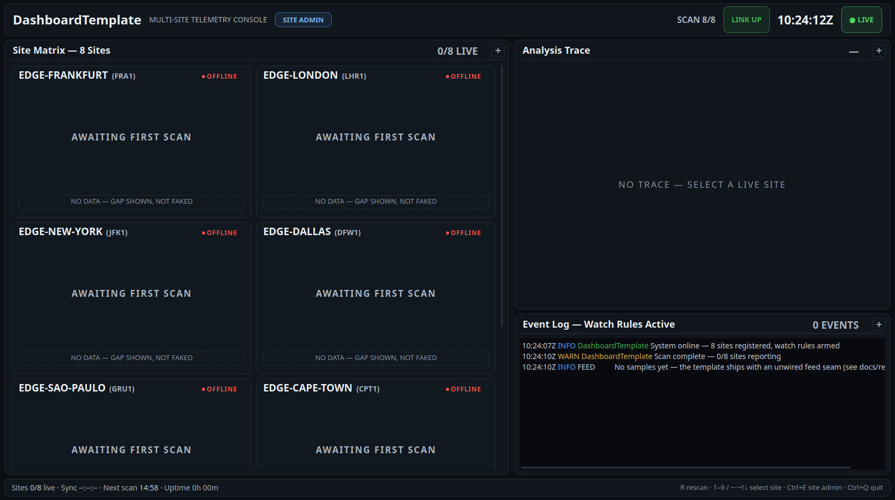

# dashboard-template-qt-cpp

A Qt 6 / C++20 **template repository** for NOC-style telemetry dashboards:
an editable roster of watched sites, a staggered polling service, watch
rules that log raise *and* clear, and a fully custom-painted dark console —
charcoal-blue chassis, white headline values, muted gray labels, and one
saturated accent per data domain. No bitmap assets, no stylesheets on
instrument surfaces, one executable.

Use **"Use this template"**, then make it yours in two commands:

```bash
scripts/rename-project.sh FleetConsole    # rebrand + self-verifying build
# implement your data source in src/FeedService.cpp::pollSite() — one
# function, fully documented (docs/recipes.md "Wire a feed")
```



The screenshot shows the honest day-zero state: the feed seam is
intentionally unwired, so every site renders its explicit gap
("AWAITING FIRST SCAN" — gaps shown, never faked) until you wire a source.
The scan cycle, countdown, link semantics, alerting and admin UI are all
live.

## What you get

- **Site matrix** — custom-painted instrument tiles: site name + code,
  online indicator, primary-metric readout and trend chip, segmented
  0–100 gauge on a cold→hot ramp with threshold ticks, metric rows,
  trailing sparkline with HI/LO, and a data-age footer. Pending sites
  render explicit dashed placeholders — **measured, never invented**.
- **Analysis trace** — dual-scale history chart (two series, independent
  axes), subtle graticule, dashed LATEST cursor with chip readout,
  MIN/MAX annotations, self-describing legend.
- **Event log** — timestamped UTC NOC log; watch rules log on raise, on
  severity change ("raised to CRITICAL" / "lowered to WARNING") and on
  clearing ("…nominal"), severity color-coded.
- **Console chrome** — masthead, ticking UTC clock, blinking LIVE badge,
  scan progress, LINK chip that flips red on failure, status bar with
  next-scan countdown and uptime; hotkeys (`R` rescan, `1`–`9` / arrows
  select, `Ctrl+E` admin, `Ctrl+Q` quit); draggable body seam and
  per-panel expand.
- **Site admin** — roster editor (add / update / remove / reorder /
  reset), persisted to the user's config dir with crash-safe writes and
  corrupt-file fallback to defaults. Roster is hot-swappable at runtime:
  samples survive an edit, superseded in-flight replies are retired.
- **Packaging** — one-liner Docker builds for a self-contained Linux
  tarball (bundled Qt, smoke-tested) and a Windows x64 zip (mingw-w64
  cross-compile, embedded icon); app icon painted in code, rendered to a
  full icon set by script.
- **Headless verification** — `--offline`, `--grab`, `--grab-admin`,
  `--icon`: the whole console verifies offscreen in CI or on a server.

## Architecture in one paragraph

Data flows one way: `SiteRegistry` (roster, persisted JSON) →
`FeedService` (staggered round-robin polling, one in-flight request per
site, failure degrades to Stale/Error while retaining the last good
sample) → `MainWindow` (timers, alert diffing, wiring) → the painted
widgets. The feed itself is a single documented seam. Details, rationale
and the extension recipes: [docs/architecture.md](docs/architecture.md) ·
[docs/recipes.md](docs/recipes.md).

## Build & run

Requires Qt 6 (Widgets + Network), CMake ≥ 3.21, a C++20 compiler.

```bash
cmake -B build -DCMAKE_BUILD_TYPE=Release
cmake --build build -j
./build/DashboardTemplate
```

Useful flags (see `--help`):

```bash
./build/DashboardTemplate --offline            # link-down drill, no polling
./build/DashboardTemplate --grab frame.png     # render one frame after the first scan, then exit
./build/DashboardTemplate --icon icon.png      # render the app icon, then exit
```

## Packaging

One-liners from the repo root with Docker installed (images build on first
use; artifacts land in `dist/`, gitignored). Host Qt 6 Gui + CMake +
Ninja + python3 needed for icon rendering.

| Target | Command | Artifact |
|---|---|---|
| Linux x86_64 | `packaging/linux/build-linux.sh` | `dist/DashboardTemplate-<ver>-linux-x86_64.tar.gz` |
| Windows 10/11 x64 | `packaging/windows/build-win64.sh` | `dist/DashboardTemplate-<ver>-win64.zip` |

Details, bundle policies and verification: [docs/packaging.md](docs/packaging.md).

## Extending

[docs/recipes.md](docs/recipes.md) walks through the four common changes —
each names the exact seams:

- **Wire a feed** — replace the stub in `FeedService::pollSite()`;
  `applySample()` / `applyFailure()` do the rest.
- **Add a data domain** — model field → feed parse → card row → chart
  series → watch rule, with a claimed accent.
- **Add a watch rule** — a guarded threshold in `evaluateAlerts()` with a
  stable key; the log handles raise/severity/clear.
- **Rename the project** — `scripts/rename-project.sh NewName`.

Working with AI agents on a derived project? `AGENTS.md` carries the
operational guide (build, headless verification, invariants, design
rules) — keep it updated.

## License

MIT — see [LICENSE](LICENSE). Icon artwork is verbatim
[Bootstrap Icons](https://icons.getbootstrap.com) v1.11.3 path data
(© 2019–2024 The Bootstrap Authors, MIT), converted at runtime by the
parser in `src/widgets/IconGlyph.h`.
